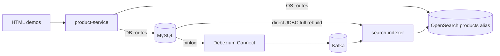

# Product Search Platform

Spring Boot product catalog with separate MySQL and OpenSearch search paths.
MySQL is authoritative; OpenSearch is a rebuildable search projection.

## Technical Highlights

- MySQL is the transactional source of truth; OpenSearch stores a denormalized,
  rebuildable product read model.
- The standalone search-indexer reads MySQL directly for full rebuilds and
  consumes Debezium/Kafka events for incremental updates.
- CDC handlers resolve related-row changes to affected product IDs, then
  rebuild each projection from the latest MySQL state.
- Product ID is the OpenSearch document ID, making repeated upserts idempotent.
- Full rebuilds create a new physical index and switch the `products` alias
  after bulk indexing succeeds.
- CDC processing uses manual acknowledgment, up to 3 configurable 1-second
  retries, and a dead-letter topic; polling is capped at 50 records by default.
- DB and OpenSearch search/suggestion APIs are separate routes; neither route
  silently falls back to the other backend.
- OpenSearch keyword weights are `name` 3x, `sku` 2.5x, `brand` 2x,
  `categories` 1.5x, `attributes.value` 1.2x, and `description` 1x.
- OpenSearch search supports brand/category/SKU/attribute/availability and
  price-range filters, sorting, and zero-based pagination (20 default, 100
  maximum).
- OpenSearch suggestions use case-insensitive contains and phrase-prefix
  matching and return at most 10 deduplicated suggestions.
- With CDC enabled, MySQL-to-OpenSearch propagation is eventually consistent.
  Separate DB routes provide a comparison baseline; benchmark results have
  not been collected.
- Actuator is included; full-sync progress and indexing/search failures are
  logged. Custom sync-latency or search-performance metrics are not configured.

## Tech Stack

| Area | Technologies |
|---|---|
| Backend | Java 21, Spring Boot 4.2.0, Spring WebMVC, Spring Data JPA, Spring JDBC, Spring Kafka, Actuator |
| Database | MySQL, Flyway |
| Search | OpenSearch 3, OpenSearch Java client 3.10.0, full-text search, suggestions, filtering, sorting, pagination |
| Event pipeline | Apache Kafka 3.9.1, Debezium Connect 3.3.2.Final, CDC, eventual consistency, idempotent indexing, retry/DLQ |
| Testing | Spring Boot Test, JUnit, Mockito; no Testcontainers dependency |
| Infrastructure | Docker Compose for OpenSearch, Kafka, and Debezium; MySQL is external |
| CI/CD | GitHub Actions pull-request workflow |

Actuator provides Micrometer-backed framework instrumentation, but this
repository does not configure custom indexing/search metrics or a Prometheus
registry. There are no Prometheus/Grafana Compose services. CI runs MySQL and
OpenSearch as GitHub Actions service containers rather than using
Testcontainers.

## Architecture



See [architecture](docs/architecture.md) for boundaries and decisions.

## Local setup

Requirements: Java 21, Maven, Docker, and a MySQL server reachable on port
3306. MySQL is not included in the repository's Compose files.

1. Create the database:

   ```sql
   CREATE DATABASE product_search;
   ```

2. Set product-service database credentials if they differ from the local
   defaults:

   ```bash
   export SPRING_DATASOURCE_URL=jdbc:mysql://localhost:3306/product_search
   export SPRING_DATASOURCE_USERNAME=root
   export SPRING_DATASOURCE_PASSWORD=your-password
   ```

3. Start OpenSearch:

   ```bash
   docker compose -f infrastructure/opensearch/docker-compose.yml up -d
   ```

4. Start product-service. Flyway applies the catalog migrations and seed data:

   ```bash
   mvn -f product-service/pom.xml spring-boot:run
   ```

5. Build the initial search index from MySQL:

   ```bash
   DB_URL=jdbc:mysql://localhost:3306/product_search \
   DB_USER=root DB_PASSWORD=your-password \
   mvn -f search-indexer/pom.xml spring-boot:run \
     '-Dspring-boot.run.arguments=--search-indexer.full-sync-on-startup=true,--spring.kafka.admin.auto-create=false'
   ```

6. Open `http://localhost:8080/index.html`. Use `?engine=os` to open the
   OpenSearch demo directly.

Search-indexer defaults are in
[`application.properties`](search-indexer/src/main/resources/application.properties).
Full sync and CDC are disabled by default. For Kafka/CDC setup, follow
[cdc-pipeline](docs/cdc-pipeline.md).

## API routes

| Backend | Search | Suggestions |
|---|---|---|
| MySQL | `GET /api/v1/products/search/db` | `GET /api/v1/products/suggestions/db?q=...` |
| OpenSearch | `GET /api/v1/products/search/os` | `GET /api/v1/products/suggestions/os?q=...` |

The two backends are selected by route; there is no engine-switch parameter.

## Tests

With MySQL available, run each Maven module:

```bash
mvn -f product-service/pom.xml verify
mvn -f search-indexer/pom.xml verify
```

The product-service integration tests also need OpenSearch and a populated
`products` index/alias. The GitHub Actions workflow provisions these
dependencies and runs a full sync before testing.

## Documentation

- [Architecture](docs/architecture.md)
- [Database design](docs/database-design.md)
- [Search engineering](docs/search-engineering.md)
- [CDC pipeline](docs/cdc-pipeline.md)
- [Failure handling](docs/failure-handling.md)
- [Performance benchmark](docs/performance-benchmark.md)
