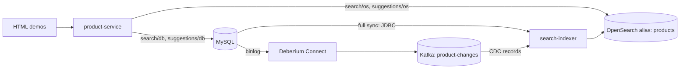

# Architecture

## Component interactions

## Ownership

| Component | Responsibility |
|---|---|
| MySQL | Transactional catalog and authoritative state |
| product-service | DB- and OpenSearch-backed search and suggestions APIs |
| Debezium Connect | MySQL binlog capture and Kafka publication |
| Kafka | Durable buffering of CDC records |
| search-indexer | Direct-JDBC rebuilds and CDC projection updates |
| OpenSearch | Denormalized, rebuildable search read model |

## Decisions

- MySQL is the source of truth. OpenSearch can be rebuilt from it.
- DB and OpenSearch API routes are explicit; a request never selects or falls
  back between backends.
- product-service does not call or control search-indexer.
- search-indexer reads MySQL directly for full sync and CDC projection reloads;
  it exposes no HTTP controller.
- CDC events identify affected products. The indexer reloads the current
  relational projection instead of treating event payloads as complete
  documents.
- Full rebuilds write a new physical index and switch the `products` alias
  after bulk indexing succeeds.
- When CDC is enabled, changes become visible in OpenSearch after asynchronous
  event processing; MySQL remains authoritative during that interval.
- Separate DB-backed routes provide a relational-search comparison baseline.
  Performance measurements are tracked separately and have not yet been
  collected.

See [search-engineering](search-engineering.md),
[cdc-pipeline](cdc-pipeline.md), and
[failure-handling](failure-handling.md) for implementation details.
