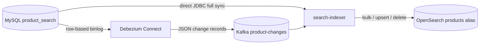

# CDC Pipeline

The `search-indexer` is a standalone worker. It reads MySQL directly for full
sync and consumes Debezium JSON records from Kafka for incremental updates.
It has no HTTP controller; product-service owns both DB and OpenSearch APIs.

## Data flow



Full sync reads MySQL in ascending product-ID batches (default 100, range
1–1000), assembles each complete product projection, and bulk indexes into a
new physical index. It switches the `products` alias after indexing completes.
Full sync does not use Kafka or a product-service endpoint.

## Incremental updates

The connector template captures these tables:

`products`, `brands`, `categories`, `product_categories`, `product_variants`,
`product_prices`, `product_components`, `product_attributes`, `inventory`, and
`warehouses`.

The connector uses database `product_search`, topic prefix `product-search`,
and `snapshot.mode=initial`. Its RegexRouter SMT routes the matching
`product-search.product_search.<table>` topics to `product-changes`. JSON
converters have schemas disabled. Each event carries a Debezium envelope; the
indexer reads `source.table` and collects IDs from both `before` and `after`,
resolves affected product IDs, then reloads current projections from MySQL:

| Changed table | Product-ID resolution |
|---|---|
| `products` | Row `id` |
| `product_variants`, `product_prices`, `product_categories`, `product_components`, `product_attributes` | Row `product_id` |
| `inventory` | `variant_id` → `product_variants.product_id` |
| `brands` | Brand `id` → `products.brand_id` |
| `categories` | Category `id` → `product_categories.product_id` |
| `components` | Component `id` → `product_components.product_id` |
| `warehouses` | Warehouse `id` → inventory → variant → product |

Existing products are upserted; products no longer present are deleted.
Document IDs are the MySQL product IDs, so replay updates the same document.
The listener acknowledges a record only after the resulting OpenSearch writes
succeed. Changes to shared rows such as brands, categories, components, and
warehouses can resolve to multiple products, and each affected projection is
reloaded. See [failure handling](failure-handling.md) for retry and DLQ
behavior.

## Local configuration

Both features are disabled by default:

```properties
search-indexer.full-sync-on-startup=false
search-indexer.cdc.enabled=false
```

Start the local Kafka and Debezium Connect services:

```bash
docker compose -f infrastructure/kafka/docker-compose.yml up -d
```

Configure MySQL row-based binlogging and a connector user with the required
read and replication privileges. Replace the credential placeholders and
ensure `database.hostname` in
[`mysql-connector.example.json`](../infrastructure/kafka/mysql-connector.example.json)
is reachable from the Connect container. Register the connector with Connect
on port 8083:

```bash
curl -X POST http://localhost:8083/connectors \
  -H 'Content-Type: application/json' \
  --data @infrastructure/kafka/mysql-connector.example.json
```

For initial setup, enable both flags so the startup runner performs the full
sync before starting the CDC listener. For normal CDC operation, disable full
sync and keep CDC enabled. A standalone rebuild uses full sync enabled and CDC
disabled. To run both startup steps:

```bash
DB_URL=jdbc:mysql://localhost:3306/product_search \
DB_USER=root DB_PASSWORD=your-password \
mvn -f search-indexer/pom.xml spring-boot:run \
  '-Dspring-boot.run.arguments=--search-indexer.full-sync-on-startup=true,--search-indexer.cdc.enabled=true'
```

The indexer reads:

| Property | Default |
|---|---|
| `DB_URL` | `jdbc:mysql://localhost:3306/product_search` |
| `DB_USER` / `DB_PASSWORD` | `root` / `password` |
| `opensearch.host` / `opensearch.index` | `http://localhost:9200` / `products` |
| `KAFKA_BOOTSTRAP_SERVERS` | `localhost:9092` |
| `search-indexer.cdc.topic` | `product-changes` |
| `search-indexer.cdc.dlt-topic` | `product-changes.DLT` |

Configuration source:
[`search-indexer/src/main/resources/application.properties`](../search-indexer/src/main/resources/application.properties).

## Boundaries and verification

- No full-sync or CDC endpoint exists in product-service or search-indexer.
- Starting Kafka alone does not register or start the MySQL connector.
- CDC startup requires an existing OpenSearch index/alias.
- Unit/projection tests do not constitute a live MySQL → Debezium → Kafka →
  OpenSearch test. Verify connector status, topic records, consumer lag, and
  the indexed product in an environment running the complete pipeline.
