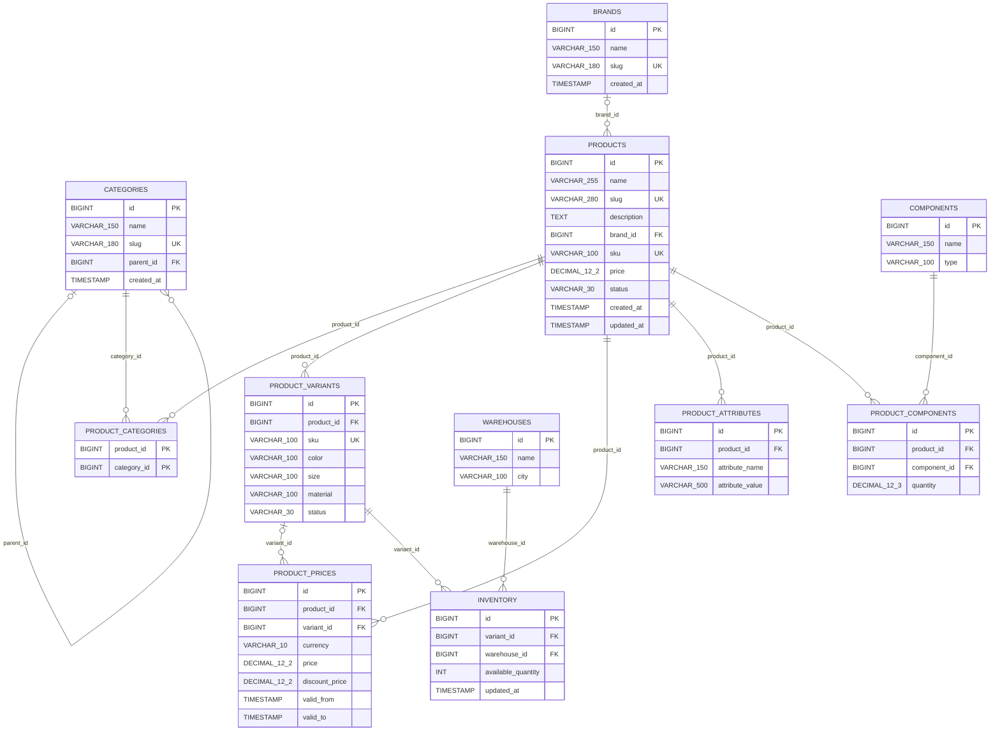

# Database Design

MySQL database: `product_search`. DDL and seed data are managed by Flyway in
[`product-service/src/main/resources/db/migration`](../product-service/src/main/resources/db/migration).

## Entity relationships

## Tables and constraints

| Table | Key columns and constraints |
|---|---|
| `brands` | `id` PK; `name VARCHAR(150)`; unique `slug VARCHAR(180)` |
| `categories` | `id` PK; unique `slug`; nullable `parent_id` self-FK |
| `products` | `id` PK; unique `slug` and product `sku`; nullable `brand_id`; `price DECIMAL(12,2)`; `status` |
| `product_categories` | Composite PK `(product_id, category_id)`; both columns are FKs |
| `product_variants` | `id` PK; `product_id` FK; unique variant `sku`; color, size, material, status |
| `product_prices` | `id` PK; `product_id` FK; nullable `variant_id` FK; currency, price, discount, validity dates |
| `product_attributes` | `id` PK; `product_id` FK; `attribute_name`, `attribute_value` |
| `components` | `id` PK; name and type |
| `product_components` | `id` PK; product/component FKs; unique `(product_id, component_id)`; quantity |
| `warehouses` | `id` PK; name and city |
| `inventory` | `id` PK; variant/warehouse FKs; unique `(variant_id, warehouse_id)`; available quantity |

## Schema decisions

- Products and categories are many-to-many through `product_categories`; there
  is no `products.category_id`.
- Product and variant SKUs are independently unique.
- `products.price` is the product-level price. `product_prices` stores
  currency- and optional variant-specific prices.
- Inventory is variant/warehouse-specific. Search availability is derived from
  whether any variant has positive inventory.
- `flyway_schema_history` is migration metadata, not a catalog entity.
- The schema source of truth is the Flyway migration set, not this summary.

The OpenSearch projection is documented in
[search-engineering](search-engineering.md).
