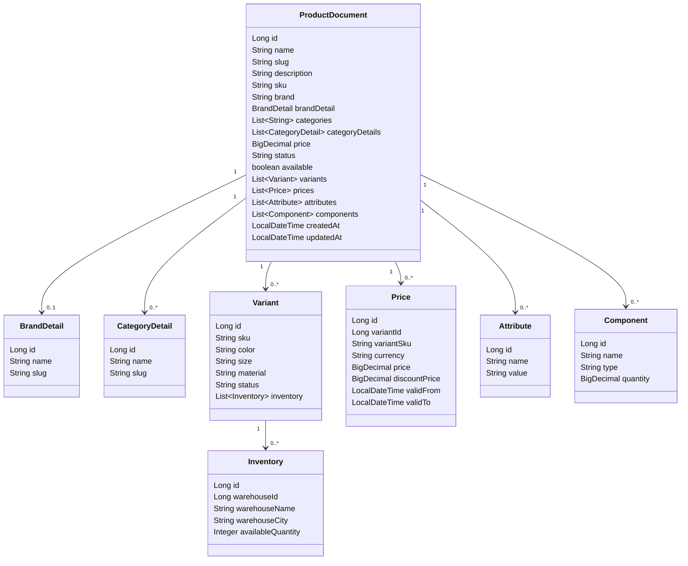

# Search Engineering

OpenSearch is a denormalized read model of the MySQL catalog. One document
represents one product; `_id` is the MySQL product ID. The document type is
[`ProductDocument.java`](../search-indexer/src/main/java/com/productsearch/search_indexer/document/ProductDocument.java).

## Product document model

`available` is true when any variant has positive inventory.
`ProductDocument.price` comes from `products.price`; `prices` contains the
separate currency- and optional variant-level rows. The full projection and
example document are in
[`ProductProjectionReader.java`](../search-indexer/src/main/java/com/productsearch/search_indexer/service/ProductProjectionReader.java)
and [`ProductDocument.java`](../search-indexer/src/main/java/com/productsearch/search_indexer/document/ProductDocument.java).

## Explicit mappings

| Field | Mapping | Use |
|---|---|---|
| `id` | `long` | Product identity |
| `name` | `text`, `keyword` subfield (`ignore_above: 256`) | Search, exact sort |
| `slug` | `keyword` | Exact lookup |
| `description` | `text` | Search and suggestions |
| `sku`, `brand`, `categories` | `keyword` | Exact filters and suggestions |
| `price` | `double` | Range filter and sort |
| `status` | `keyword` | Exact status |
| `available` | `boolean` | Availability filter |
| `createdAt`, `updatedAt` | `date` | Sort |
| `variants.sku` | `keyword` | Variant SKU filter |
| `attributes.name` | `keyword` | Attribute-name filter |
| `attributes.value` | `text` | Search and suggestions |

Other serialized fields, including `brandDetail`, `categoryDetails`, `prices`,
`components`, and `inventory`, are dynamically mapped. `variants` and
`attributes` are regular objects, not `nested` mappings. Add and test mappings
before querying dynamic fields as exact filters, sorts, or aggregations. The
explicit mappings are created in
[`ProductIndexingService.java`](../search-indexer/src/main/java/com/productsearch/search_indexer/service/ProductIndexingService.java).

No custom analyzer or edge-ngram mapping is configured. Text fields use
OpenSearch's default analyzer; keyword fields retain exact values.

## Query and ranking behavior

- `GET /api/v1/products/search/os` uses `keyword` for a boosted `multi_match`:
  `name^3`, `sku^2.5`, `brand^2`, `categories^1.5`,
  `attributes.value^1.2`, and `description^1`.
- Additional criteria are ANDed; brand/category/availability/SKU filters use
  exact terms, and price uses a numeric range.
- Supported filters include `brand`, `brandId`, `category`, `categoryId`,
  `sku`, `attribute`, `minPrice`, `maxPrice`, and `available`.
- `page` is zero-based; default page size is 20 and the service caps it at 100.
  The controller defaults to `createdAt` descending. Name and price sorting
  are supported; relevance scores are used when no recognized sort is present.
- Suggestions use case-insensitive contains wildcards and phrase-prefix
  matches across brand, category, name, SKU, attribute value, and description.
  The service reads up to 20 product hits and returns at most 10 deduplicated
  suggestions.

Contains suggestions use leading wildcards, which can be expensive on large
indices. Measure this query before scaling the catalog; no n-gram optimization
is currently configured.

## Index lifecycle

- Product-service queries the configured `products` index/alias.
- Full sync writes to `products-rebuild-<uuid>`, then switches the `products`
  alias after all bulk writes succeed.
- Mapping changes require a full rebuild into a new physical index.
- DB routes remain separate: `/api/v1/products/search/db` and
  `/api/v1/products/suggestions/db`.

See [database design](database-design.md),
[cdc-pipeline](cdc-pipeline.md), and
[failure handling](failure-handling.md).
